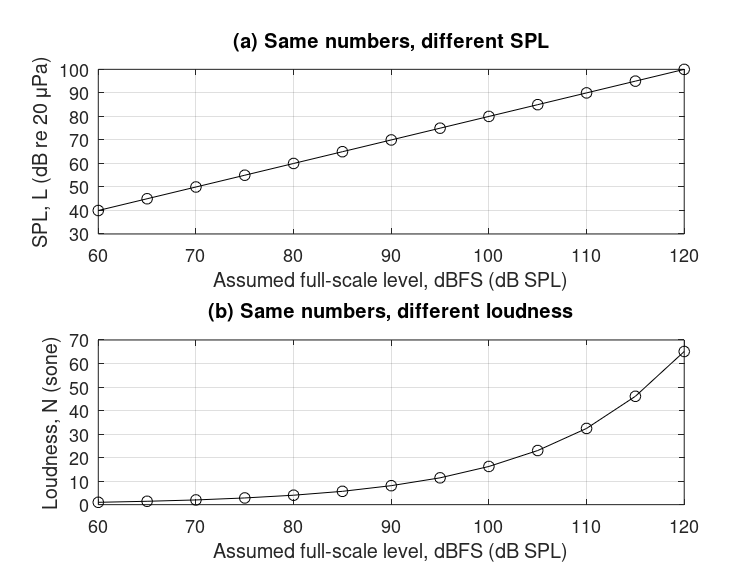
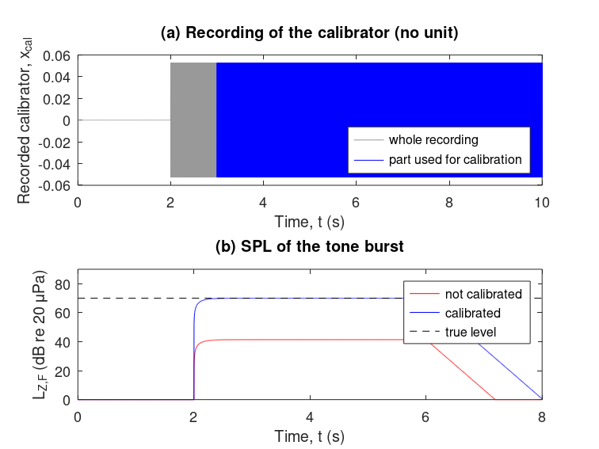
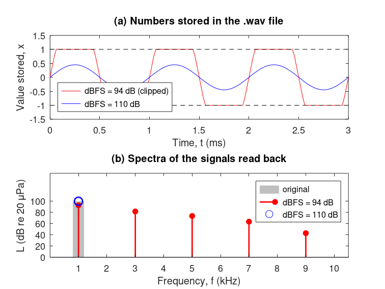
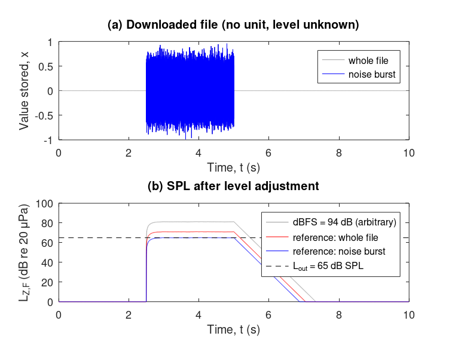

# About these codes
A digital signal, e.g. read from a `.wav` file, is a sequence of numbers $x(t)$ without units. All SQAT functions, however, expect a sound pressure signal $p(t)$ in Pa. **Calibration** is the step that converts the numbers into Pa. Without it, the computed metrics have no physical meaning.

The codes in this folder explain, with signals generated in the code itself, why calibration is needed and how to do it in SQAT. They are meant to be read and run in order:

| Code | Question | Method in [1] |
| --- | --- | --- |
| `ex1_why_calibrate.m` | Why do I need to calibrate a signal? | |
| `ex2_calibrator.m` | I recorded a sound level calibrator. How do I use it? | Indirect method (Section 3.3.1) |
| `ex3_wav_dBFS.m` | I know the full-scale level (dBFS) of my file. What does it mean? | Scaling of WAV files (Section 3.3.2) |
| `ex4_level_adjustment.m` | I have no information about the level, e.g. a file downloaded from the internet. What can I do? | Level adjustment (Section 3.3.3) |

# The full-scale level (dBFS) in SQAT
In SQAT, the link between the numbers and the sound pressure is given by the **full-scale level**, dBFS: the sound pressure level (SPL), in dB SPL, of a signal with an rms value of 1. The signal in Pa is

$$p(t) = x(t)\, p_0\, 10^{\,\mathrm{dBFS}/20} \approx x(t)\, 10^{\,(\mathrm{dBFS}-94)/20},$$

where $p_0 = 20~\mu\mathrm{Pa}$. By default, dBFS = 94 dB SPL, i.e. a value of 1 corresponds to 1 Pa. The three calibration methods described in [1] are just different ways to find dBFS:

| Information available | dBFS | Code |
| --- | --- | --- |
| Recording $x_\mathrm{cal}$ of a calibrator with level $L_\mathrm{cal}$ | $\mathrm{dBFS} = L_\mathrm{cal} - 20\log_{10}(x_{\mathrm{cal,rms}})$ | 2 |
| dBFS used to write the file | known ($94~\mathrm{dB} - L_\mathrm{att}$ in Eq. (3.2) of [1]) | 3 |
| None: assume a level $L_\mathrm{out}$ for (a part of) the signal, $x_\mathrm{ref}$ | $\mathrm{dBFS} = L_\mathrm{out} - 20\log_{10}(x_{\mathrm{ref,rms}})$ | 4 |

The first and the last cases are computed by the `calibrate.m` function (`utilities` folder), which returns the signal in Pa and the corresponding dBFS:

```matlab
[p, CalFactor, dBFS] = calibrate(x, x_ref, L_ref); % p = CalFactor * x
```

Here, `x_ref` is either the calibrator recording (with `L_ref` the calibrator level) or the signal itself (with `L_ref` the assumed level). Substituting dBFS into the equation above yields Eqs. (3.1) and (3.3) of [1], respectively.

> [!NOTE]
> **dBFS in SQAT is not the dBFS of audio software.** In audio engineering, 0 dBFS usually refers to a full-scale *sinusoid* (peak value of 1, rms value of 0.707) [3]. In SQAT, dBFS refers to an rms value of 1. With the default dBFS = 94 dB SPL, the largest sinusoid that fits in a file therefore has 91 dB SPL. Also, 1 Pa corresponds to 93.98 dB SPL, which SQAT rounds to 94 dB SPL.

> [!TIP]
> In the SQAT GUI (`gui/SQAT_GUI.m`), the calibration dialog offers the same three options: *Full-scale level (dBFS)*, *Calibrator recording* and *Relative level*.

# How to use these codes
All codes are self-contained: the signals are generated within each code, so no sound files are needed. Simply run them to reproduce the figures shown below. Set `save_figs = 1` to save the figures in the `figs` folder.

# 1. Why calibrate?
`ex1_why_calibrate.m` generates a 1-kHz tone with an rms value of 0.1, as it could be stored in a `.wav` file, and converts the *same numbers* to Pa assuming different dBFS values. For each assumption, the SPL and the loudness (`Loudness_ISO532_1`) are computed.

The SPL simply follows the assumed dBFS (a), but the loudness does not (b): it roughly doubles every 10 dB. The same file yields 1 sone (40 dB SPL, the reference condition of ISO 532-1 [2]) or 65 sone (100 dB SPL), depending only on the assumption. Psychoacoustic metrics depend non-linearly on the level, so **a wrong level cannot be corrected afterwards by an offset**: the signal must be calibrated before computing them.



# 2. Calibration using a sound level calibrator
`ex2_calibrator.m` generates the sound pressure of a calibrator (94 dB SPL, 1 kHz) and of a sound to be measured (500-Hz tone burst, 70 dB SPL). Both are "recorded" by a measurement chain (microphone, amplifier and analog-to-digital converter) whose gain is unknown. Because the level of the calibrator is known, the whole chain can be treated as a black box [1]:

```matlab
[p, CalFactor, dBFS] = calibrate(x, x_cal(idx_stable), 94);
```

Without calibration, the recording reads about 29 dB too low; after calibration, the SPL matches the true level (b). The dBFS returned by `calibrate.m` is the full-scale level of the measurement chain: any other file recorded with the same setup and settings can be converted to Pa using this value.

**Use only the stable part of the calibrator recording** (blue in (a)). `calibrate.m` uses the rms value of the whole reference signal. In this example, keeping the 2 s of silence at the start of the 10-s recording yields a calibration that is 1 dB off.



Further recommendations:
- record the calibrator with the same setup and settings (gain, sampling frequency) as the measurement, and record it again if anything changes;
- calibrate each channel (microphone) separately;
- do not normalize or change the gain of a file in an audio editor after calibration, as this changes its dBFS.

# 3. Full-scale level (dBFS) and .wav files
`ex3_wav_dBFS.m` generates a 1-kHz tone with 100 dB SPL, whose peaks reach 2.8 Pa, and writes it to a 16-bit `.wav` file using dBFS = 94 dB and dBFS = 110 dB:

```matlab
audiowrite(fname, p / 10^((dBFS-94)/20), fs);  % writing: Pa -> numbers
x = audioread(fname);  p = x * 10^((dBFS-94)/20);  % reading: numbers -> Pa
```

A `.wav` file can only store values between -1 and +1, and MATLAB clips any value outside this range (with a warning). With the default dBFS = 94 dB, the tone is clipped (a): it is read back with a wrong level (93.3 instead of 100 dB SPL) and with harmonics that were not present in the original signal (b). With dBFS = 110 dB, the signal fits in the file and is read back correctly. The dBFS used to write a file must be known to read it: the same file read with the default dBFS = 94 dB yields 84 dB SPL, i.e. 16 dB too low.

Choose a dBFS slightly above the highest level expected, but not much higher: a 16-bit file has a dynamic range of about 96 dB below full scale.



# 4. Level adjustment (no calibration information)
`ex4_level_adjustment.m` generates a "downloaded" file: a 2.5-s noise burst within a 10-s file, normalized to a peak value of 0.99, as done by many audio editors. Its original level is unknown, so it cannot be recovered. Read with the default dBFS = 94 dB, it yields an arbitrary level (grey in (b)). What can be done is to assume a level, $L_\mathrm{out}$ = 65 dB SPL, and adjust the signal to it, using the signal itself as reference:

```matlab
p = calibrate(x, x(idx_burst), 65);  % reference: the noise burst only
```

`calibrate.m` sets the rms value of the reference signal to $L_\mathrm{out}$. If the whole file is used as reference, the silence is included in the rms value, and the noise burst ends up 6 dB louder than intended (red in (b)), i.e. $10\log_{10}(10~\mathrm{s}/2.5~\mathrm{s})$. **Choose the reference part of the signal on purpose.**

Results obtained after level adjustment are only valid under the assumed level. This approach is mainly useful to compare different signals at the same level, or to set the level of synthetic signals.



# References
[1] Felix Greco, G. (2026). Sound quality analysis of virtual aircraft prototypes: framework development and application. Doctoral thesis, Technische Universität Braunschweig, Section 3.3. DOI: [10.24355/dbbs.084-202512262308-0](https://doi.org/10.24355/dbbs.084-202512262308-0)

[2] ISO 532-1:2017. Acoustics — Methods for calculating loudness — Part 1: Zwicker method. International Organization for Standardization, Geneva, Switzerland.

[3] AES17-2020. AES standard method for digital audio engineering — Measurement of digital audio equipment. Audio Engineering Society, New York, USA.

# Log
These codes were added in November 2026.
