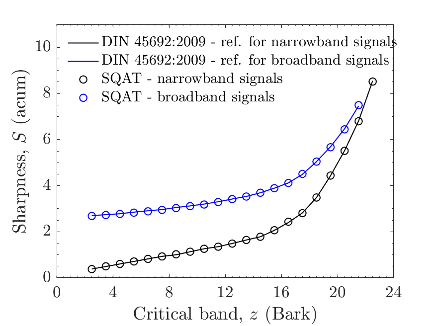
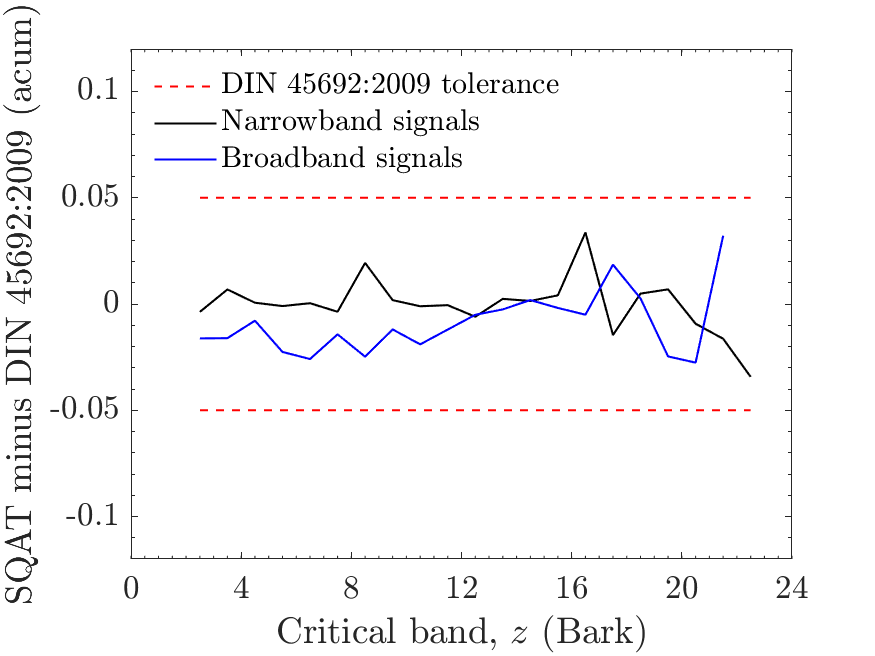
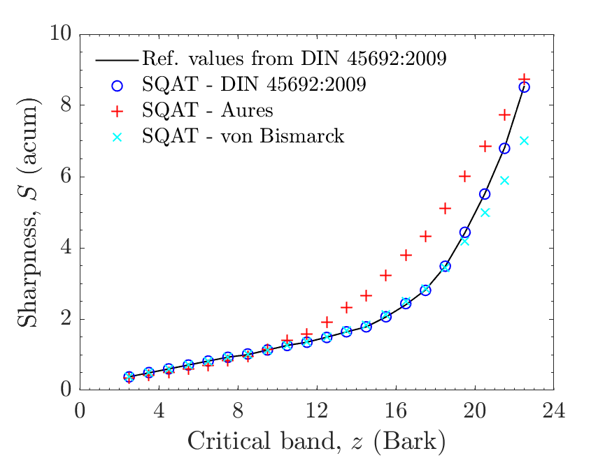
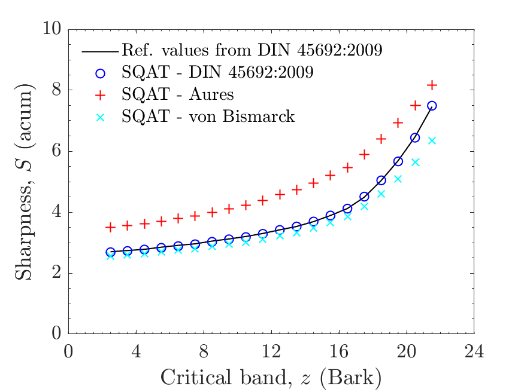

# Sharpness according to DIN 45692: verification of the implementation in SQAT 
The `validation_Sharpness_DIN45692_narrowband_and_broadband_signals.m` code is used to verify the sharpness implementation according to DIN 45692 [1] (see `Sharpness_DIN45692`code [here](../../psychoacoustic_metrics/Sharpness_DIN45692/Sharpness_DIN45692.m)). The verification is performed considering test signals as specified by the DIN norm, which consist of: 

- 21 narrowband sounds (one-critical-band wide) with center frequencies in Bark (from $2.5~\mathrm{Bark}$ to $22.5~\mathrm{Bark}$ in $1~\mathrm{Bark}$ steps), and
- 20 broadband sounds with variable lower frequencies in Bark (from $2.5~\mathrm{Bark}$ to $21.5~\mathrm{Bark}$ in $1~\mathrm{Bark}$ steps) and fixed upper frequency of $10~\mathrm{kHz}$ ($\approx 22.4~\mathrm{Bark}$). 

All test signals are stationary noises with a total loudness of $4~\mathrm{sone}$. Since November 2026, the code generates them as ideal bandpass noise (flat spectrum, random phase) with the critical band edges of Zwicker [7], and sets each one to $4~\mathrm{sone}$ (ISO 532-1 [2], stationary).

# How to use this code
No external dataset is needed: the test signals are generated within the code.

# Results
The figures below compare the results obtained using the `Sharpness_DIN45692` implementation in SQAT with reference values from the DIN norm [1]. The DIN norm stipulates a tolerance of 5 % or 0.05 acum from the provided reference values; the figures and the code use the stricter 0.05 acum. The loudness of the test signals is obtained using the loudness method for stationary signals according to ISO 532-1 [2], as implemented in SQAT (see `Loudness_ISO532_1` [here](../../psychoacoustic_metrics/Loudness_ISO532_1/Loudness_ISO532_1.m)).
  
Absolute values |  Relative error 
 | -------------- | -------------- |
|        |      |

All 41 signals are within the tolerance: the largest deviation is 0.036 acum for the narrowband signals (RMS 0.013 acum) and 0.033 acum for the broadband signals (RMS 0.018 acum).

## The data set of SQAT v1.x
Up to SQAT v2.0, the code used the test signals provided in the Zenodo dataset of SQAT v1.0 [(doi:10.5281/zenodo.7933206)](https://doi.org/10.5281/zenodo.7933206). All of them were calibrated against the reference signal, which is a 1 kHz tone at 60 dB SPL instead of the narrowband noise the standard defines (issue [#89](https://github.com/ggrecow/SQAT/issues/89)). As a result, their loudness was 4.1 to 4.5 sone instead of the 4 sone required by the standard (issue [#90](https://github.com/ggrecow/SQAT/issues/90)). The loudness enters the Aures weighting function explicitly. The other two are normalised by it, but the shape of the specific loudness pattern still depends on the level: between 4 and 4.5 sone, the sharpness changes by up to 0.02 acum, against up to 0.08 acum for the Aures weighting function. The Zenodo dataset is kept unchanged, so that the SQAT v1.x results remain reproducible with the code of those versions.

# Comparison of weighting functions
The DIN standard [1] defines three weighting functions for the calculation of sharpness. The standard weighting function $g(z)$ (also called the DIN 45692 weighting function) is based on the work of Widmann [3]. The two additional weighting functions $g_{\mathrm{B}}(z)$ and $g_{\mathrm{A}}(z)$ were developed by von Bismarck [4] and Aures [5], respectively. 

As the sharpness results may significantly differ depending on the weighting function and the test signals, it is recommended to adequately report the method used for the sake of clarity. This is also the case for the method used to compute the loudness. Moreover, the selection of the weighting function has to be carefully made depending on the test sounds [6]:

- The level-independent weighting functions $g(z)$ and $g_{\mathrm{B}}(z)$ are recommended if the sounds to be compared have similar loudness. 
- The weighting function $g_{\mathrm{A}}(z)$ accounts for the influence of the total loudness and is thus recommended if the test sounds have a significant loudness difference. 

The figure below presents a comparison of sharpness values obtained using the three different weighting functions. The results are obtained using the `Sharpness_DIN45692` implementation in SQAT and the narrowband and broadband test signals specified by the DIN standard [1]. 

Narrowband signals |  Broadband signals 
 | -------------- | -------------- |
|        |      |

# References
[1] Deutsches Institut für Normung. (2009). Measurement technique for the simulation of the auditory sensation of sharpness (DIN Standard No. 45692).

[2] International Organization for Standardization. (2017). Acoustics - Methods for calculating loudness - Part 1: Zwicker method (ISO Standard No. 532-1).

[3] Widmann, U. (1993). Untersuchungen zur Schärfe und zur Lästigkeit von Rauschen unterschiedlicher Spektralverteilung. Fortschritte der Akustik – DAGA 93, 644–647.

[4] von Bismarck, G. (1974). Sharpness as an Attribute of the Timbre of Steady Sounds. Acustica, 30(3), 159–172. [(link)](https://dael.euracoustics.org/bin/EAA/v3.20/quickview?id=54732)

[5] Aures, W. (1985). Berechnungsverfahren für den sensorischen Wohlklang beliebiger Schallsignale (A model for calculating the sensory euphony of various sounds). Acustica, 59(2), 130–141. [(link)](https://dael.euracoustics.org/bin/EAA/v3.20/quickview?id=58433)

[6] HEAD acoustics. (2018). Psychoacoustic analyses I. Application note. [(link)](https://cdn.head-acoustics.com/fileadmin/data/global/Application-Notes/SVP/Psychoacoustic-Analyses-I_e.pdf) (last viewed December 5, 2024)

[7] Zwicker, E. (1961). Subdivision of the audible frequency range into critical bands (Frequenzgruppen). The Journal of the Acoustical Society of America, 33(2), 248.

# Log
This code was released in SQAT v1.0, 14.05.2023

November 2026: the test signals are generated within the code and set to 4 sone (issue [#90](https://github.com/ggrecow/SQAT/issues/90)).
